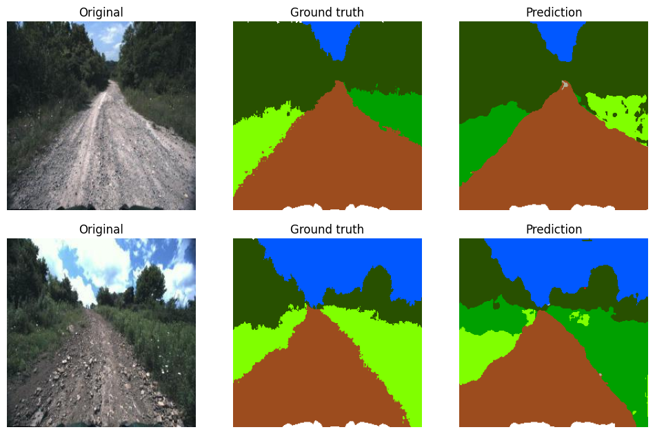

# Off-Road Terrain Segmentation

**Nine-class semantic segmentation of off-road driving scenes with U-Net.**

Computer Vision project of *Bocconi Students for Machine Learning (BSML)*, 2025–26. I led a team of five; this repository contains my notebooks for the data pipeline and the U-Net experiments.

<p align="center">
  
</p>
<p align="center"><sub>Validation images, ground truth and predictions of the baseline U-Net (notebook 1).</sub></p>

**Classes:** background, sky, rough trail, smooth trail, traversable grass, high vegetation, non-traversable low vegetation, puddle, obstacle.

## Pipeline

### 1. Data preparation — [`notebooks/01_data_preparation_and_baseline.ipynb`](notebooks/01_data_preparation_and_baseline.ipynb)

- **Merging.** Combined the Yamaha-CMU Off-Road dataset (`yamaha_v0`) with a second off-road dataset from Kaggle, converting the second dataset's masks into the first one's label space: 6,012 image–mask pairs.
- **Deduplication.** Removed 1,234 near-duplicate images (cosine similarity above 0.95 between ResNet-18 embeddings), leaving 3,525 training and 1,253 validation images.
- **Class imbalance.** Puddles cover only 0.06% of training pixels. Added 2,015 rotated copies of the images richest in rare classes, cropping each rotation to its largest valid rectangle so that no black borders enter the masks; the share of non-traversable low vegetation rose from 1.9% to 8.0% of pixels. Derived log-inverse-frequency class weights for the loss.
- **Baseline.** U-Net with a ResNet-34 encoder.

### 2. Model experiments — [`notebooks/02_model_experiments.ipynb`](notebooks/02_model_experiments.ipynb)

U-Net models with ImageNet-pretrained encoders (`segmentation_models_pytorch`), trained with Adam (learning rate 1e-4) on an 80/20 split of the cleaned training set (3,334 images). All losses use log-inverse-frequency class weights; the rare classes (low vegetation, puddle, obstacle) are further up-weighted where indicated.

| Encoder | Input size | Epochs | Loss | Validation mIoU |
|---|---:|---:|---|---:|
| ResNet-18 | 192 | 5 | cross-entropy | 0.506 |
| ResNet-50 | 224 | 10 | cross-entropy | 0.495 |
| ResNet-34 | 224 | 10 | cross-entropy, rare classes ×1.5–2.5 | 0.514 |
| ResNet-34 | 224 | 10 | cross-entropy, rare classes ×2–5 | 0.536 |
| ResNet-34 | 224 | 15 | cross-entropy, rare classes ×3–10 | 0.519 |
| ResNet-34 | 256 | 25 | cross-entropy + Dice, rare classes ×5–15 | **0.555** |

For the last two runs the table reports the best epoch on the validation set.

## Results

Per-class IoU of the best model:

| Sky | Smooth trail | Trav. grass | High veg. | Background | Rough trail | Obstacle | Low veg. | Puddle |
|---:|---:|---:|---:|---:|---:|---:|---:|---:|
| 0.91 | 0.84 | 0.84 | 0.79 | 0.66 | 0.40 | 0.36 | 0.13 | 0.06 |

Large, well-represented regions are segmented reliably. Puddles and low vegetation remain the open problem: they are rare, small and visually close to neighbouring classes, which is what the class weighting and the targeted augmentation were aimed at.

## Notes on evaluation

- **Metric.** Validation mIoU is computed per image and per class, then averaged. The training loop in notebook 1 prints a batch-averaged IoU (about 0.75) that is not comparable with these figures; its per-image evaluation at the end of the notebook gives 0.53.
- **Augmentation in the last two runs of notebook 2.** These cells set `val_ds.dataset.transform = val_transform`. Because `random_split` returns two views of the same underlying dataset, this also replaced the training transform, so the photometric and geometric augmentations defined there were not applied during training. The reported numbers reflect training without them; the fix is to build separate dataset objects for the training and validation subsets.

## Repository structure

```
.
├── notebooks/
│   ├── 01_data_preparation_and_baseline.ipynb
│   └── 02_model_experiments.ipynb
├── requirements.txt
└── assets/                 Figures used in this README
```

## Running the notebooks

The datasets are not included. Place them in a `data/` folder at the repository root:

```
data/
├── yamaha_v0/{train,valid}/          Yamaha-CMU Off-Road dataset
├── dataset/{train,val}/{rgb,mask}/   Kaggle off-road segmentation dataset
├── unified_dataset/                  created by notebook 1
└── train_dataset_clean/              cleaned training set used by notebook 2
```

```bash
pip install -r requirements.txt
jupyter notebook notebooks/
```
